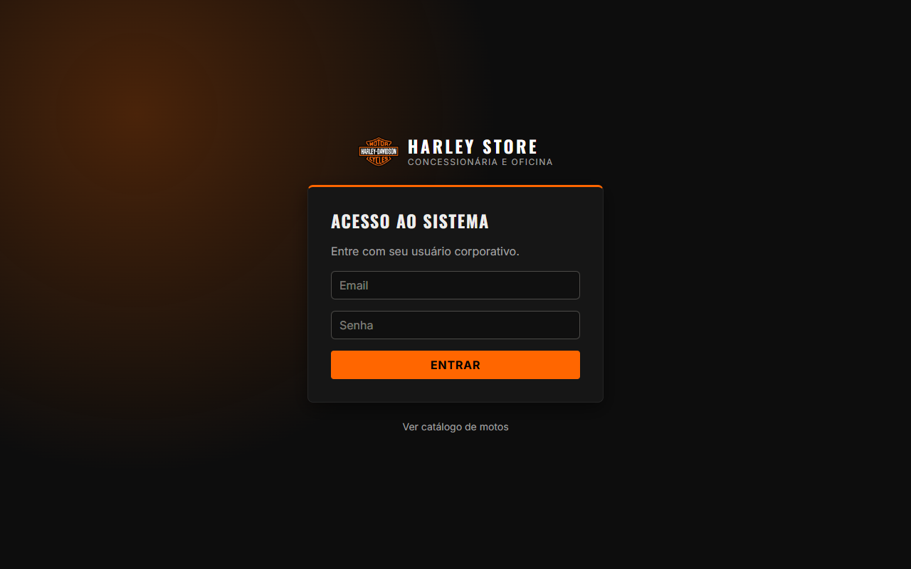
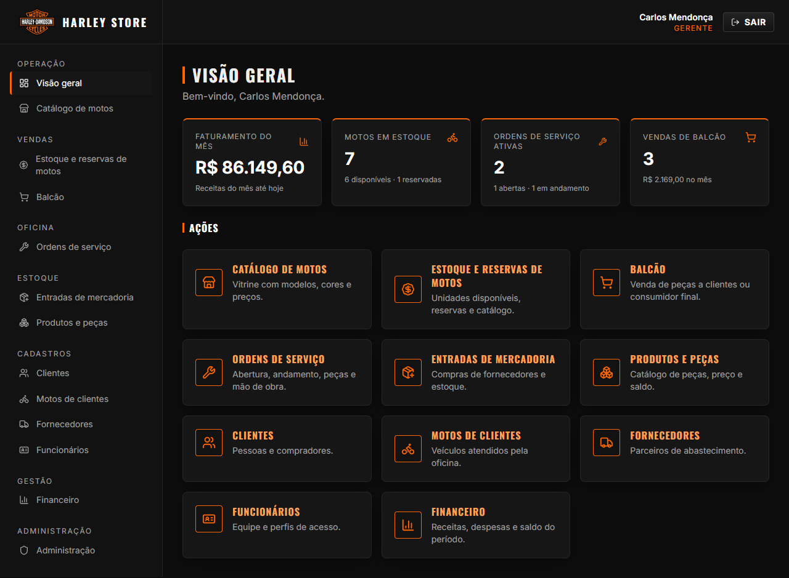
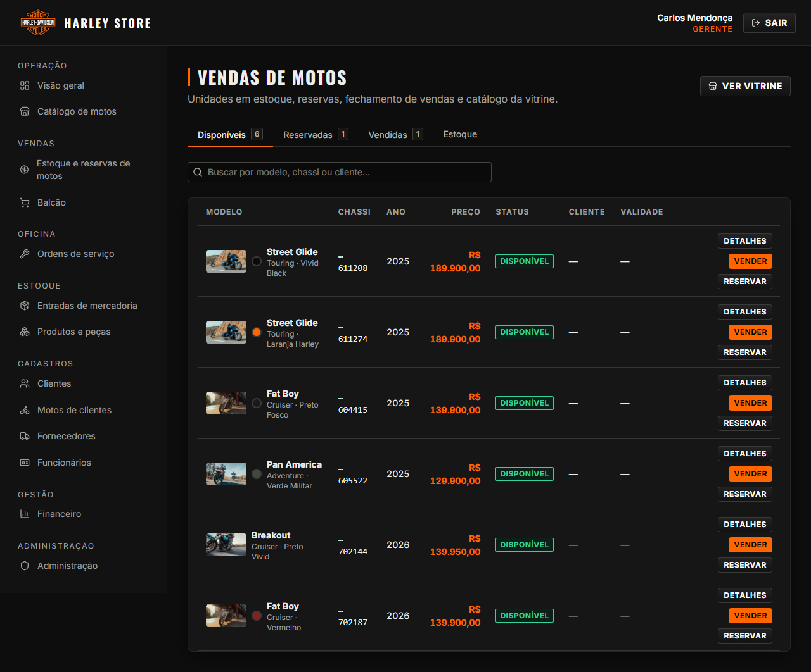
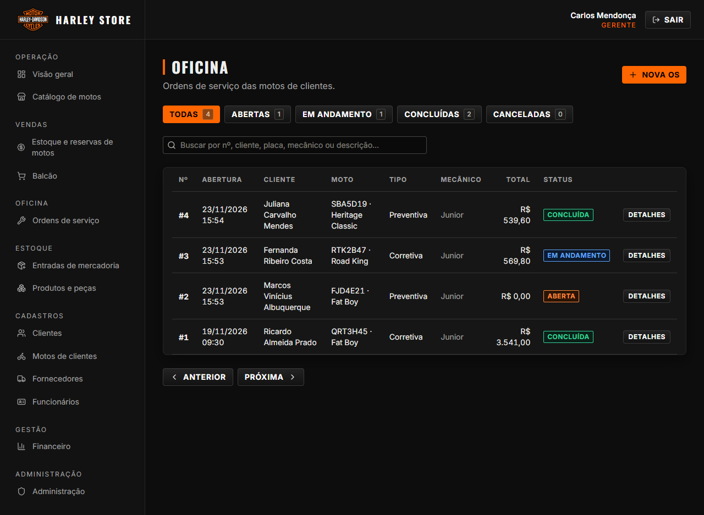
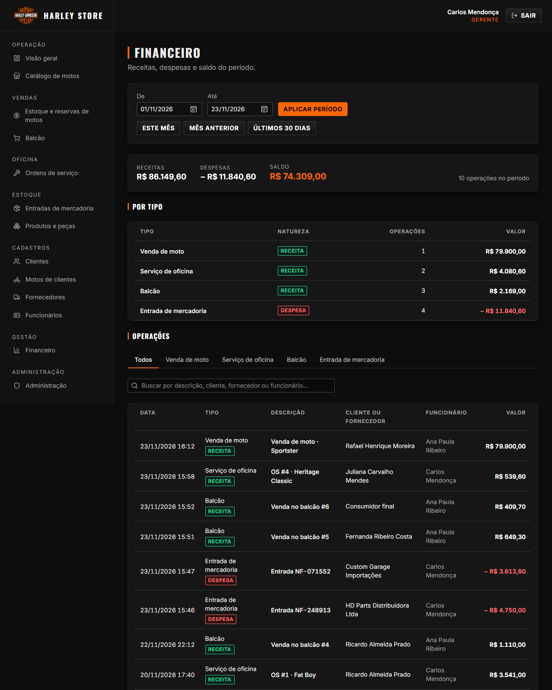
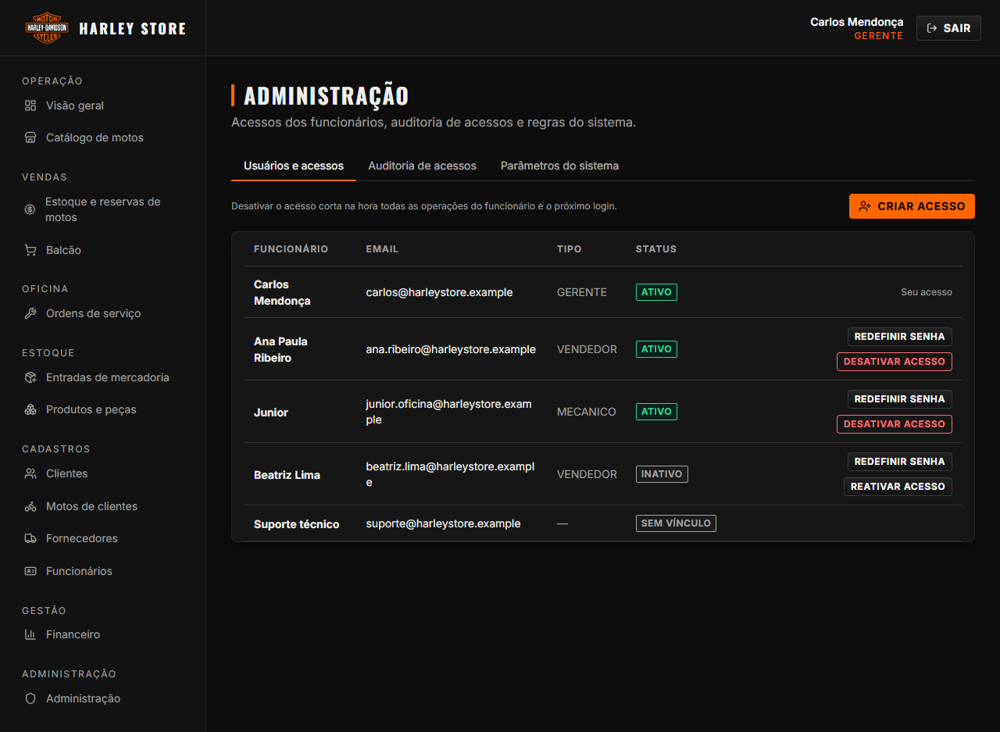

# HarleyStore — Manual de uso

Manual do aplicativo web HarleyStore para quem trabalha na loja (gerente, vendedores e mecânicos) e para quem visita a vitrine. Os detalhes técnicos ficam na pasta [`docs/`](docs/).

## 1. Apresentação

O **HarleyStore** é o sistema de gestão de uma concessionária e oficina especializada em motos Harley-Davidson. Ele reúne num só lugar o que costuma ficar espalhado em planilhas, cadernos e sistemas diferentes:

- a **vitrine pública**, com os modelos, as cores, os preços e a disponibilidade;
- a **venda de motos**, com reservas e fechamento da venda;
- a **venda de peças no balcão**;
- a **oficina**, com as ordens de serviço (OS), peças e mão de obra;
- o **estoque**, alimentado pelas compras de fornecedores;
- o **financeiro**, que soma receitas e despesas sozinho, a partir das operações da loja;
- a **administração dos acessos**, com auditoria de quem entrou e do que foi feito nos acessos.

**O problema que ele resolve:** numa loja com vendas, balcão e oficina, o estoque diverge, o histórico de cada moto se perde e o caixa do mês só fecha com retrabalho. No HarleyStore, cada venda, OS ou compra atualiza na hora o estoque e o financeiro, e tudo fica registrado com o nome de quem fez.

**Para quem é:**

- **visitantes**, que consultam a vitrine sem precisar de cadastro;
- **vendedores**, que atendem clientes, reservam e vendem motos e peças;
- **mecânicos**, que conduzem as ordens de serviço da oficina;
- **gerentes**, que acompanham tudo, cuidam das compras, do financeiro e dos acessos da equipe.

## 2. Acesso ao aplicativo

### Versão publicada

Esta entrega não tem um endereço público do aplicativo. Ele roda num computador da loja e se conecta ao servidor de dados online (Xano), onde ficam as informações. Por isso, qualquer computador com o aplicativo instalado enxerga os mesmos dados.

### Executar no computador (Windows)

Você vai precisar do Python 3.12 ou mais novo e do arquivo `.env`, com os endereços do servidor de dados. Peça esse arquivo ao responsável técnico: ele não fica no repositório.

1. Abra um terminal na pasta do projeto.
2. Prepare o ambiente (só na primeira vez):

   ```bash
   python -m venv .venv
   .venv/Scripts/python -m pip install -r requirements.txt
   ```

3. Copie o arquivo `.env` recebido para a pasta do projeto.
4. Inicie o aplicativo:

   ```bash
   .venv/Scripts/reflex run --env prod --single-port --backend-port 3100
   ```

5. Espere a mensagem `App running at: http://0.0.0.0:3100/` (a primeira vez leva cerca de 1 minuto) e abra **<http://localhost:3100>** no navegador.

Deixe o terminal aberto enquanto usar o sistema. Para encerrar, pressione `Ctrl+C` no terminal. No macOS e no Linux, troque `.venv/Scripts/` por `.venv/bin/`.

### Por onde entrar

| Endereço | O que abre | Precisa de login? |
| --- | --- | --- |
| `http://localhost:3100/` | Tela de login da equipe. Depois de entrar, mostra a **Visão geral**. | Sim |
| `http://localhost:3100/catalogo` | **Vitrine pública** de motos. | Não |

Não existe cadastro aberto: quem cria o acesso de cada funcionário é o gerente, em **Administração**.

### Para a equipe técnica

Instalação completa e variáveis: [docs/onboarding.md](docs/onboarding.md). Checks e testes: [docs/quality.md](docs/quality.md). Servidor de dados e publicação: [docs/xano-api-client.md](docs/xano-api-client.md). Organização das pastas: [docs/project-structure.md](docs/project-structure.md). Regras de cada área: [openspec/specs/](openspec/specs/).

## 3. Perfis de usuários

| Perfil | Quem é | Responsabilidades |
| --- | --- | --- |
| **Visitante** | Qualquer pessoa, sem login | Conhecer os modelos, as cores, os preços e a disponibilidade na vitrine. |
| **Vendedor** | Atendente de vendas e balcão | Cadastrar clientes e as motos deles, reservar e vender motos, vender peças no balcão e acompanhar as OS dos clientes. |
| **Mecânico** | Equipe da oficina | Abrir e conduzir ordens de serviço, lançar peças e mão de obra e concluir ou cancelar o serviço. |
| **Gerente** | Responsável pela loja | Tudo o que os outros perfis fazem, mais as compras de fornecedores, o catálogo de modelos e unidades, os cadastros de produtos, fornecedores e funcionários, o financeiro e a administração dos acessos. |

### Permissões por módulo

| Módulo | Visitante | Vendedor | Mecânico | Gerente |
| --- | --- | --- | --- | --- |
| Vitrine (`/catalogo`) | Consulta | Consulta | Consulta | Consulta |
| Visão geral | — | Motos em estoque e OS ativas | OS ativas | Todos os indicadores |
| Estoque e reservas de motos | — | Reserva, vende e cancela a própria reserva (ou uma vencida) | — | Tudo, inclusive cancelar qualquer reserva e cadastrar modelos e unidades |
| Balcão | — | Vende | — | Vende |
| Ordens de serviço | — | Consulta | Abre, conduz, lança itens, conclui e cancela | Abre, conduz, lança itens, conclui e cancela |
| Entradas de mercadoria | — | Consulta | Consulta | Registra e consulta |
| Clientes e motos de clientes | — | Cadastra, edita e desativa | Consulta | Cadastra, edita e desativa |
| Produtos e peças | — | Consulta | Consulta | Cadastra, edita e desativa |
| Fornecedores e funcionários | — | — | — | Cadastra, edita e desativa |
| Financeiro | — | — | — | Consulta |
| Administração | — | — | — | Gerencia acessos e consulta a auditoria |

O menu lateral mostra só o que o perfil pode usar. Se alguém abrir um endereço de outro perfil, vê a mensagem de acesso negado. O servidor de dados confere a permissão de novo em cada operação.

## 4. Funcionalidades

### Principais

- **Vitrine pública:** modelos ativos com foto, família (Touring, Cruiser, Adventure e Sport), cores, preço "a partir de" e quantas unidades estão disponíveis ("Sob consulta" quando não há nenhuma). Tem filtro por família, busca por nome e detalhes com galeria de fotos.
- **Motos e vendas:**
  - unidades separadas em Disponíveis, Reservadas e Vendidas, com busca por modelo, chassi ou cliente;
  - reserva para um cliente, com validade de 7 dias por padrão (até 30);
  - cancelamento da reserva com motivo;
  - fechamento da venda, que cria a moto no cadastro do cliente e lança a receita no financeiro.
- **Venda de balcão:** busca de peças, carrinho com até 30 itens, cliente opcional ("consumidor final"), conferência do total antes de confirmar, baixa automática do estoque e recibo.
- **Oficina (ordens de serviço):**
  - abertura da OS para a moto de um cliente, com mecânico, tipo (preventiva ou corretiva), descrição do problema e quilometragem;
  - acompanhamento da OS por status: Aberta, Em andamento, Concluída e Cancelada;
  - lançamento de peças (que saem do estoque) e de mão de obra;
  - totais da OS;
  - histórico de status e histórico de serviços de cada moto.
- **Estoque e compras:** registro das entradas de mercadoria de cada fornecedor, com número do documento e até 50 itens. A entrada aumenta o saldo das peças e lança a despesa no financeiro. As entradas e o detalhe de cada uma ficam disponíveis para consulta.
- **Financeiro:** receitas, despesas e saldo de um período (de até 366 dias), com atalhos para "Este mês", "Mês anterior" e "Últimos 30 dias". Mostra os totais por tipo e a lista das operações (até 500 por período), com filtro por tipo e busca.

### Complementares

- **Visão geral:** indicadores do dia a dia conforme o perfil (faturamento do mês, motos em estoque, OS ativas e vendas de balcão) e atalhos para cada módulo.
- **Cadastros:** clientes (CPF ou CNPJ único), motos de clientes (placa e chassi únicos), produtos e peças (código único, preço e saldo), fornecedores (CNPJ único) e funcionários (vendedor, mecânico ou gerente). Nada é apagado: os registros são desativados e continuam no histórico.
- **Catálogo de modelos e unidades** (gerente): modelos com fotos e cores, e cadastro de unidades com chassi de 17 caracteres.
- **Administração e auditoria** (gerente):
  - criação de acesso para um funcionário;
  - redefinição de senha;
  - desativação e reativação de acesso;
  - auditoria de logins, criações de acesso e trocas de senha;
  - consulta aos parâmetros do sistema.

## 5. Manual de utilização

O passo a passo segue a jornada de cada perfil. As telas abaixo mostram dados de demonstração.

### 5.1 Visitante: consultar a vitrine

1. Abra `http://localhost:3100/catalogo`.
2. Use as abas **Todas, Touring, Cruiser, Adventure e Sport** ou o campo **Buscar modelo**.
3. Clique em **Detalhes** ou em **Fale com um vendedor** para ver a galeria, as cores e o preço.

**Resultado esperado:** você vê só os modelos ativos e a quantidade disponível de cada um. Reservas e vendas são feitas na loja, com um vendedor; o detalhe do modelo traz essa orientação. Dados internos, como chassi, clientes e reservas, nunca aparecem na vitrine.


### 5.2 Equipe: entrar e sair

1. Abra `http://localhost:3100/` ou clique em **Área do colaborador** na vitrine.
2. Informe o email e a senha e clique em **Entrar**.
3. Para sair, clique em **Sair**, no canto superior direito.

**Resultado esperado:** a **Visão geral** abre com os indicadores do seu perfil e os atalhos para os módulos liberados. A sessão dura até 24 horas.





### 5.3 Vendedor: atender, reservar e vender

#### Cadastrar o cliente e a moto dele

1. Em **Cadastros → Clientes**, clique em **Novo cadastro**, preencha nome, CPF ou CNPJ, telefone, email e endereço e salve.
2. Se o cliente trouxer uma moto para a oficina, cadastre-a em **Cadastros → Motos de clientes**, com modelo, placa e chassi.

*Resultado:* o cliente passa a aparecer nas reservas, nas vendas, no balcão e na abertura de OS. O sistema recusa CPF ou CNPJ, placa ou chassi repetidos.

#### Reservar uma moto

1. Abra **Estoque e reservas de motos** e, na aba **Disponíveis**, clique em **Reservar** na unidade desejada.
2. Escolha o cliente, ajuste a validade (7 dias por padrão, até 30) e confirme em **Confirmar reserva**.

*Resultado:* a unidade vai para a aba **Reservadas**, com o cliente, o vendedor e a validade, e deixa de contar como disponível na vitrine. Para desfazer, use **Cancelar reserva** e informe o motivo. Quem reservou pode cancelar, o gerente também e, depois do vencimento, qualquer vendedor.

#### Vender uma moto

1. Clique em **Vender** na unidade (disponível, ou reservada para o mesmo cliente).
2. Confira o cliente e o valor, informe a placa se a moto já estiver emplacada e clique em **Confirmar venda**.

*Resultado:* a unidade vai para a aba **Vendidas** e a moto entra no cadastro do cliente, pronta para a oficina. A receita aparece no **Financeiro** na hora.



#### Vender peças no balcão

1. Abra **Balcão**, busque a peça pelo nome ou código e clique em **Adicionar**. Repita para cada item, ajustando as quantidades.
2. Escolha o cliente ou deixe como consumidor final.
3. Confira o total, clique em **Fechar venda** e confirme.

*Resultado:* o sistema mostra o recibo, baixa o estoque de cada peça e lança a receita de balcão no financeiro. Se o preço ou o saldo mudar enquanto você monta o carrinho, a venda é recusada antes de gravar e nada é cobrado. Clique em **Nova venda** para começar outro atendimento.

### 5.4 Mecânico: conduzir a ordem de serviço

1. Abra **Ordens de serviço** e clique em **Nova OS**.
2. Escolha a moto do cliente, o mecânico responsável, o tipo (preventiva ou corretiva), a quilometragem e descreva o problema. Salve.
3. Na lista, clique em **Detalhes** e depois em **Iniciar serviço** quando a moto entrar na oficina.
4. Em **Adicionar item**, lance as peças usadas (escolha **Peça**, o produto e a quantidade) e a mão de obra (escolha **Serviço**, a descrição e o valor).
5. Ao terminar, clique em **Concluir OS**. Se o serviço não for feito, use **Cancelar OS** e informe o motivo.

**Resultado esperado:**

- a moto só pode ter uma OS em aberto por vez;
- cada peça lançada sai do estoque na hora;
- a OS mostra os totais de peças e de mão de obra e o histórico de status;
- na conclusão, o valor da OS entra como receita no **Financeiro**;
- no cancelamento, as peças voltam ao estoque e nenhuma receita é lançada.

OS concluídas e canceladas não mudam mais. O vendedor acompanha as OS, mas não altera nada.



### 5.5 Gerente: compras, catálogo, cadastros e financeiro

#### Registrar a compra de peças

1. Abra **Entradas de mercadoria** e clique em **Nova entrada**.
2. Escolha o fornecedor e informe o número do documento (a nota fiscal).
3. Para cada peça, informe a quantidade e o valor unitário. Use **Adicionar item** para mais linhas, até 50.
4. Clique em **Registrar entrada**.

*Resultado:* o saldo de cada peça aumenta e a despesa aparece no **Financeiro**. O mesmo documento não pode ser lançado duas vezes para o mesmo fornecedor.

#### Cuidar do catálogo e das unidades

1. Em **Estoque e reservas de motos**, abra a aba **Estoque**.
2. Use **Novo modelo** para cadastrar um modelo (família, preço base, fotos e cores) e **Nova unidade** para cadastrar uma moto à venda (modelo, cor, ano, preço e chassi de 17 caracteres, sem as letras I, O e Q).

*Resultado:* o modelo aparece na vitrine e a unidade entra como **Disponível**. O chassi não pode repetir nem o de uma moto de cliente.

#### Manter os cadastros

Em **Cadastros**, o gerente cuida de **Produtos e peças**, **Fornecedores** e **Funcionários**, além de clientes e motos. Para tirar algo de uso, clique em **Desativar**: o registro some das listas de escolha, mas continua no histórico de vendas, OS e entradas.

#### Acompanhar o financeiro

1. Abra **Financeiro**. O período começa no mês atual.
2. Troque as datas em **De** e **Até** e clique em **Aplicar período**, ou use os atalhos **Este mês**, **Mês anterior** e **Últimos 30 dias**.
3. Filtre as operações pelas abas (Venda de moto, Serviço de oficina, Balcão e Entrada de mercadoria) ou pela busca.

*Resultado:* você vê as receitas, as despesas e o saldo, os totais por tipo e cada operação, com data, cliente ou fornecedor e funcionário. O financeiro só lê o que as operações gravaram: não há lançamento manual.



### 5.6 Administração: acessos e auditoria

#### Criar o acesso de um funcionário

1. Cadastre o funcionário em **Cadastros → Funcionários**, com o tipo (vendedor, mecânico ou gerente).
2. Em **Administração → Usuários e acessos**, clique em **Criar acesso**, escolha o funcionário e informe o email e uma senha temporária, com pelo menos 8 caracteres, letras e números.
3. Passe a senha ao funcionário pessoalmente: o sistema não a envia por email.

#### Redefinir uma senha

Clique em **Redefinir senha** na linha da pessoa e informe a nova senha temporária. A nova senha vale a partir do próximo login. Não é possível redefinir a própria senha por aqui, nem a de outro gerente ou do suporte técnico.

#### Desativar ou reativar um acesso

Clique em **Desativar acesso** e confirme. A pessoa perde na hora todas as operações e não consegue mais entrar. O painel não oferece essa ação na sua própria linha e avisa antes de desativar o último gerente ativo. Para devolver o acesso, use **Reativar acesso**.

#### Consultar a auditoria e os parâmetros

- A aba **Auditoria de acessos** lista logins, criações de acesso e trocas de senha, com filtro por ação e período.
- A aba **Parâmetros do sistema** mostra os limites em vigor, só para consulta: prazos da reserva, itens por venda e por entrada, e período e operações do financeiro.



## 6. Exemplos de utilização

Os cenários abaixo mostram como uma operação alimenta as outras. Os números são os das telas de demonstração.

**Compra de peças que vira despesa.** O gerente registra a nota NF-248913 da HD Parts Distribuidora com:

- 40 litros de óleo 20W50 a R$ 54,00;
- 20 filtros a R$ 72,50;
- 30 velas a R$ 38,00.

O saldo das três peças sobe na hora, e o **Financeiro** passa a mostrar a despesa "Entrada NF-248913", de R$ 4.750,00.

**Venda no balcão.** A vendedora vende à cliente Fernanda 4 litros de óleo, 1 filtro e 2 velas. O sistema confere o total de R$ 649,30, emite o recibo, baixa as 7 unidades do estoque e lança a receita de balcão.

**Reserva de uma unidade.** Um cliente quer pensar até o fim de semana. A vendedora reserva a Street Glide prata por 5 dias:

- a moto sai da aba Disponíveis;
- a vitrine deixa de contá-la;
- ninguém consegue vendê-la a outro cliente.

Se a reserva vencer, qualquer vendedor pode cancelá-la, informando o motivo.

**Venda de moto que vira receita.** A vendedora fecha a venda da Sportster 2026 grafite para o cliente Rafael por R$ 79.900,00. Ao mesmo tempo:

- a unidade vai para a aba Vendidas;
- a moto entra no cadastro do Rafael, pronta para a primeira revisão;
- o Financeiro registra a receita.

**OS concluída que vira receita.** O mecânico Junior abre uma OS preventiva para a Heritage Classic da cliente Juliana e clica em **Iniciar serviço**. Depois lança 4 litros de óleo (R$ 359,60, que saem do estoque) e R$ 180,00 de mão de obra. Ao clicar em **Concluir OS**, os R$ 539,60 entram como receita de "Serviço de oficina". Se a OS fosse cancelada, o óleo voltaria ao estoque e nada seria cobrado.

**O mês fechado no financeiro.** Com essas operações e as anteriores do mês, o **Financeiro** mostra:

| Indicador | Valor |
| --- | --- |
| Receitas | R$ 86.149,60 (vendas de motos, oficina e balcão) |
| Despesas | R$ 11.840,60 (compras de fornecedores) |
| Saldo | R$ 74.309,00 |

**Gestão de acessos.** A loja contrata o mecânico Marcelo e a vendedora Beatriz deixa a empresa:

1. O gerente cadastra Marcelo em **Funcionários**, cria o acesso dele em **Administração** e entrega a senha temporária pessoalmente.
2. O gerente desativa o acesso da Beatriz, que fica bloqueada na hora.
3. A **Auditoria de acessos** registra a criação do acesso e, depois, o primeiro login do Marcelo.

## 7. Limitações conhecidas

Esta é a versão entregue, com estas limitações:

- **Sem exclusão definitiva:** clientes, peças, fornecedores, funcionários e modelos são **desativados**, nunca apagados, para preservar o histórico financeiro e a auditoria. Vendas, OS concluídas e entradas registradas não podem ser editadas.
- **Sem alerta de estoque mínimo:** a tela de produtos mostra o saldo de cada peça, mas não avisa quando ele fica baixo. Hoje, quem confere é a equipe.
- **Senha redefinida e sessão aberta:** a nova senha vale a partir do próximo login, mas uma sessão que a pessoa já tinha aberta continua válida até expirar (no máximo 24 horas). Para bloquear alguém na hora, desative o acesso.
- **Limite de requisições do plano gratuito do servidor de dados:** são cerca de 10 operações a cada 20 segundos. Se você clicar muito rápido, pode aparecer uma mensagem de excesso de requisições: espere alguns segundos e tente de novo. A vitrine guarda o catálogo por 60 segundos, o que reduz esse efeito para os visitantes.
- **Tudo é gravado no ambiente real:** o plano atual não tem um ambiente separado de testes. Toda venda, OS ou entrada feita no sistema fica registrada.
- **Sem endereço público:** o aplicativo roda num computador da loja (seção 2). A vitrine só fica acessível na internet depois de publicada.
- **Vitrine sem reserva on-line:** o visitante consulta, mas reserva e compra com um vendedor, na loja.
- **Senhas não são enviadas por email:** o gerente informa a senha temporária pessoalmente. A redefinição da senha de outro gerente não é feita pelo painel: cada gerente troca a própria.
- **Proteção do último gerente só na tela:** o painel não deixa o gerente desativar o próprio acesso e avisa antes de desativar o último gerente ativo. A mesma alteração feita pelo cadastro de funcionários não é bloqueada.
- **Fotos da vitrine:** as fotos atuais vêm do site do fabricante. Troque-as por fotos próprias ou licenciadas antes de divulgar a vitrine.
